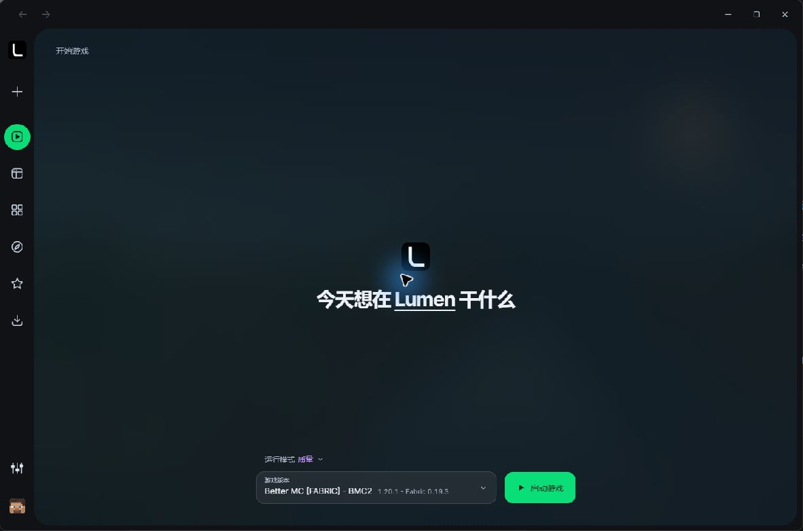
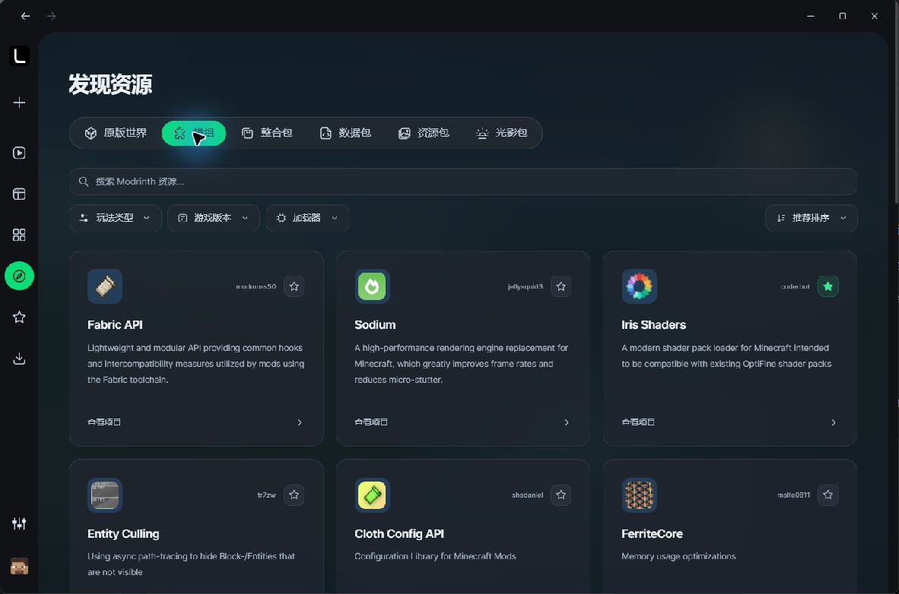

  

<h1 align="center">Lumen</h1>

  A lightweight Minecraft Java Edition launcher for Windows. 
  Independent instances. Clear resource management. A focused desktop experience.

  <strong>Windows 10 / 11 x64</strong> &nbsp; | &nbsp; Rust + Tauri 2 &nbsp; | &nbsp; Private preview

---

## A look inside

Lumen brings game installation, resource discovery, and instance management into a compact desktop interface. It is being developed with an emphasis on low idle overhead, clear installation states, and protecting existing game data.

Home / dark theme / current desktop build

Resource discovery / current desktop build

Screenshots were captured from the installed desktop build on **October 26, 2026**. The current interface is in Simplified Chinese; this project overview is provided in English.

## What Lumen does

| | |
| --- | --- |
| **Independent instances** | Keep each instance's mods, saves, and settings separate. |
| **Resource discovery** | Search public Modrinth projects and filter by resource type, Minecraft version, and loader. |
| **Modpack import** | Import supported `.mrpack` files and install their declared game and loader versions. |
| **Download control** | Pause, resume, retry, and cancel tasks, with content checks and scoped cache cleanup. |
| **Java selection** | Detect compatible Java installations, choose a runtime, or confirm a managed runtime installation. |
| **Real game logs** | Inspect the actual output of a launched game instance. |

The current native installation scope targets **Minecraft 1.20.1 and newer releases**, with supported Fabric, Quilt, Forge, and NeoForge profiles. Compatibility depends on the particular game, loader, and modpack version.

## Honest installation states

A completed download is not always a complete modpack. Some packs declare additional resources outside their main download index.

Lumen checks indexed files, override content, and supported author-provided external-resource lists. When required external files are unavailable, the instance is marked as needing resources, with official project links and a local batch-import workflow. It does not silently remove a pack's checks or claim that missing files are installed.

## Project status

Lumen is currently in **small-scale private testing**. There is no public installer release yet.

- **Working in the current preview:** offline-account launching, native game installation, public Modrinth discovery, supported modpack import, Java selection, download management, and real game logs.
- **Planned / pending access:** CurseForge API integration for project metadata, exact file selection, dependency resolution, and downloads permitted by each author's distribution settings.
- **Still in development:** Microsoft account authentication, signed automatic updates, and several of the additional workspace tools shown in the application.

Preview features can change. File-level installation checks and launch preparation do not imply that every modpack has completed a gameplay compatibility test.

## Respecting creators

Lumen intends to credit resource authors and link to their official project pages. Platform integrations must respect API policies and authors' distribution settings. Resources that cannot be obtained automatically remain explicit rather than being silently substituted.

**This repository hosts project information, the project webpage, and interface screenshots only. It does not host Minecraft, mod, resource-pack, shader, or modpack binaries. The launcher's application source code is not published here.**

## Feedback

Questions and preview feedback are welcome through [GitHub Issues](https://github.com/NazunaTes/lumen-launcher/issues). Please remove account information, tokens, and other private details before sharing logs or screenshots.

---

Lumen is an independent project and is not an official Minecraft product. It is not affiliated with Mojang or Microsoft. Third-party names and artwork visible in screenshots belong to their respective owners.
